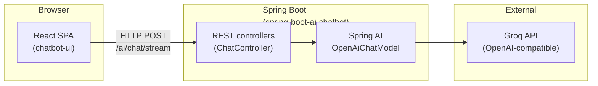
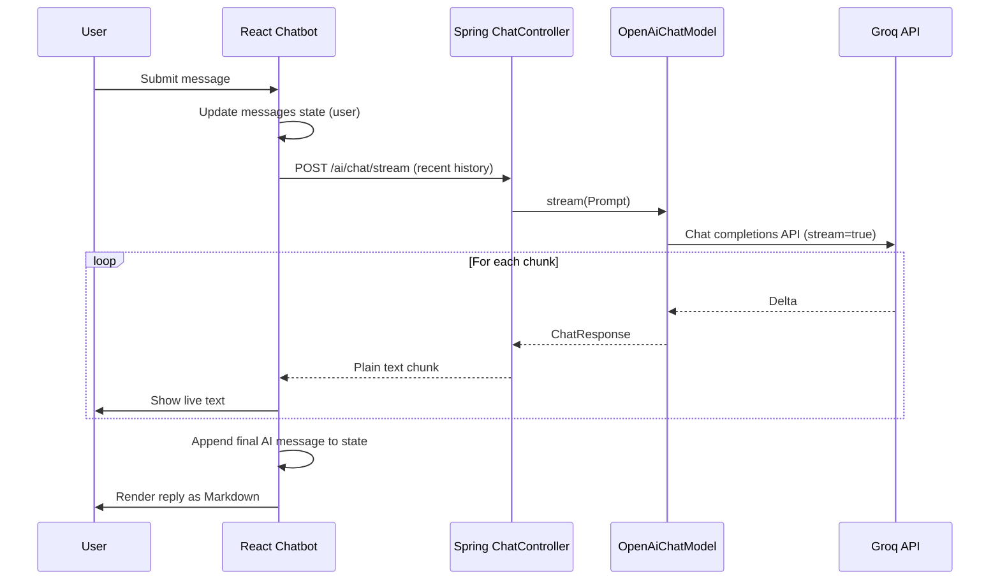

# Spring AI Chatbot

Documentation for this repository: what it does, what changed recently, how it is structured, which technologies it uses, how requests flow through the system, and how to run it locally or with Docker.

---

## Abstract

This project is a **full-stack chat assistant** demo. A **React** web UI collects user messages and sends them to a **Spring Boot** backend. The backend uses **Spring AI** with an **OpenAI-compatible** HTTP API; by default it targets **Groq** (see `application.yaml`). The repository is split into two applications (`spring-boot-ai-chatbot` and `chatbot-ui`) and can be orchestrated with **Docker Compose** so the API and the static UI run in containers on a shared network.

---

## What's new (recent updates)

These updates extend the original template: Groq-oriented configuration, safer secrets handling, a smoother dev experience, and clearer errors.

| Area | What was added or changed |
|------|---------------------------|
| **Groq** | `application.yaml` sets `spring.ai.openai.base-url` to Groq’s OpenAI-compatible endpoint and `spring.ai.openai.chat.options.model` to **`openai/gpt-oss-20b`** (temperature `0.7`). Override with `GROQ_MODEL` (for example a Groq web-search model, after checking it is available to your key). `spring.application.name` is **`demo`**. |
| **Secrets** | No API keys in git. `groq.api.key: ${GROQ_API_KEY:}` feeds `spring.ai.openai.api-key`. Create a key in the [Groq Console](https://console.groq.com/) → **API keys**, then `export GROQ_API_KEY="gsk_..."` before starting the backend (Compose passes the same variable). If the key is missing or empty, the app **still starts** (health checks pass) and chat endpoints return **503**. |
| **Chat API** | `POST /ai/chat/stream` (used by the UI) takes JSON `{"messages":[{"role":"user","content":"..."}, ...]}` and streams the reply as **plain text** chunks. It uses the last 20 messages as context and returns **400** for an invalid body. `GET /ai/chat/stream?message=` (single message, streamed) and `GET /ai/chat/string` (whole reply at once) are also available. All return **503** if the key is missing and **502** with Groq's reason (e.g. `401 Unauthorized — Invalid API Key`) if Groq fails before replying. |
| **CORS** | `WebConfig` uses **`allowedOriginPatterns`** for `http://localhost:*`, `http://127.0.0.1:*`, `https://*.onrender.com`, `https://*.vercel.app` and `https://*.netlify.app`. |
| **Frontend** | **ChatBotAI** UI: split layout with mascot, **light/dark theme toggle** (remembered), and random suggested questions that change on every load and **New chat**. Streams replies with **`fetch`** + `ReadableStream` and renders them as **Markdown** (`react-markdown` + `remark-gfm`) with readable tables and code blocks with copy buttons. |
| **Dev proxy** | `chatbot-ui/package.json` **`"proxy": "http://localhost:8080"`** — in development the UI calls **`/ai/...`** on the CRA origin and the dev server forwards to Spring Boot (avoids cross-origin issues). Prefer leaving `REACT_APP_API_BASE_URL` unset in dev so the proxy is used. |
| **Docker** | Backend **multi-stage Dockerfile** (Maven build + Eclipse Temurin JRE). UI image builds with **Node 20** and `npm ci`. **`docker-compose.yaml`** injects **`GROQ_API_KEY`** into the backend container. |
| **Memory** | The UI sends the recent conversation with every message, so follow-up questions work. The chat is saved in the browser (`localStorage`) and survives a reload; **New chat** clears it. |
| **Tests / tooling** | Backend: `ChatControllerTest` (message mapping, limits, Groq error parsing). Frontend: `App.test.js` (history, errors, saved chats, suggestions, theme); it mocks the ESM-only `react-markdown` / `remark-gfm` so they run under `react-scripts` Jest. |
| **Examples** | `chatbot-ui/.env.example` documents when to set `REACT_APP_API_BASE_URL` (production / non-default hosts). |

**Note:** Per-client `connection-timeout` / `read-timeout` properties for Groq are **not** part of Spring AI **1.0.0-M1** configuration metadata for this starter; custom timeouts would require a dedicated HTTP client bean if you need them later.

---

## System architecture

At a high level, the browser loads the React app (served by nginx in production/Docker). The UI calls the Spring Boot REST API on port **8080**. Spring Boot uses **Spring AI** (`OpenAiChatModel`) against the configured **base URL** (default: Groq) and returns model output to the client.



**Deployment shape (Docker Compose)**

- **springboot-app**: JVM running the packaged Spring Boot JAR, port `8080` published to the host.
- **react-ui**: Multi-stage build (Node builds the app, nginx serves static files), host port `3000` mapped to container port `80`.

**How the UI reaches the API:** In **development**, Create React App **`proxy`** forwards same-origin **`/ai/*`** to `http://localhost:8080`. In **production** (e.g. static build), the UI defaults to **`http://localhost:8080`** unless you set **`REACT_APP_API_BASE_URL`** at build time (see `chatbot-ui/.env.example`). When the UI and API are both on `localhost` with published ports, that default matches a typical local Docker setup.

---

## Tech stack

| Layer | Technology | Notes |
|--------|------------|--------|
| Backend runtime | Java **17** | Required by Spring Boot 3.x parent. |
| Backend framework | **Spring Boot** `3.3.3` | Web stack, auto-configuration. |
| AI integration | **Spring AI** `1.0.0-M1` (`spring-ai-openai-spring-boot-starter`) | Milestone BOM from Spring Milestones repository. |
| LLM provider | **Groq** (default) | OpenAI-compatible API; model **`openai/gpt-oss-20b`** in `application.yaml`, overridable via `GROQ_MODEL`. Point `base-url` and model elsewhere to use OpenAI or another compatible host. |
| Backend build | **Maven** | `pom.xml` in `spring-boot-ai-chatbot/`. |
| Frontend | **React** `18`, **Create React App** (`react-scripts` `5.0.1`) | SPA in `chatbot-ui/`. |
| HTTP client (UI) | **fetch** (streaming) | Reads the `/ai/chat/stream` body chunk by chunk. |
| Markdown (UI) | **react-markdown** + **remark-gfm** | Renders the final AI reply. |
| Icons (UI) | **react-icons** | Suggestion, copy and button icons. |
| Frontend container | **Node 20** (build) + **nginx alpine** (serve) | See `chatbot-ui/Dockerfile`. |
| Backend container | **Eclipse Temurin 17 JRE** (Alpine) | Multi-stage image: Maven builds the JAR, runtime stage runs **`java -jar`**. |
| Orchestration | **Docker Compose** `3.8` | Root `docker-compose.yaml`. |

---

## Control flow

End-to-end flow when the user sends a message from the UI:

1. **User input** — The user types in the input field and submits (button or Enter) in `Chatbot.js`.
2. **Optimistic UI** — The client appends a **user** message to local React state (saved to `localStorage`), clears the input and shows a **Thinking** indicator.
3. **HTTP request** — The frontend `POST`s the last 20 messages (excluding error messages) as JSON to `/ai/chat/stream`.
4. **CORS** — `WebConfig` allows localhost plus `*.onrender.com`, `*.vercel.app` and `*.netlify.app` for cross-origin browser calls.
5. **Controller** — `ChatController` checks the key (503 if missing), calls `OpenAiChatModel.stream(Prompt)` and waits for the first chunk; if Groq fails it returns **502**, otherwise it writes each text chunk to the response as it arrives.
6. **Spring AI** — The OpenAI-compatible client uses `application.yaml` (`spring.ai.openai.base-url`, model, and API key). This project defaults the base URL to **Groq**; the key is supplied via **`GROQ_API_KEY`**.
7. **Response handling** — The UI appends each chunk to the live reply, then stores the full text as an **ai** message and renders it as Markdown. Non-2xx responses are shown as an error message.



---

## How to run

### Prerequisites

- **Groq API key** (or another key compatible with your `spring.ai.openai.base-url`). This repo wires the key through **`GROQ_API_KEY`** into `spring.ai.openai.api-key` via `application.yaml`.
- **Java 17** and **Maven** (for local backend).
- **Node.js** and **npm** (for local frontend).
- Optional: **Docker** and **Docker Compose** for containerized run.

### Configure the API key

Set **`GROQ_API_KEY`** before starting the backend (never commit the real value to git):

```bash
export GROQ_API_KEY="gsk_..."
```

For Docker Compose, set the variable in `docker-compose.yaml` or use an `.env` file; avoid wrapping the real secret in extra quote characters if your environment already treats the value as a single string.

### Run the backend locally

From the `spring-boot-ai-chatbot` directory:

```bash
cd spring-boot-ai-chatbot
mvn spring-boot:run
```

The API listens on **port 8080** by default.

### Run the frontend locally

From the `chatbot-ui` directory:

```bash
cd chatbot-ui
npm install
npm start
```

The dev server runs on **http://localhost:3000**. In development, `chatbot-ui/package.json` sets **`"proxy": "http://localhost:8080"`** so the UI calls **`/ai/...` on the same origin** and Create React App forwards them to the backend (avoids CORS). Do **not** set `REACT_APP_API_BASE_URL` to `http://localhost:8080` in dev unless you need to; that forces a cross-origin call to port 8080 instead of using the proxy.

### Run with Docker Compose

1. Export your Groq API key in the same shell (Compose substitutes it into the backend service):

   ```bash
   export GROQ_API_KEY="gsk_..."
   ```

2. From the repository root:

   ```bash
   docker compose up --build
   ```

   The backend image uses a **multi-stage Dockerfile** that runs `mvn package` inside the container, so you do not need to build the JAR on the host first.

3. Open the UI at **http://localhost:3000** (mapped to nginx on port 80 inside the `react-ui` container). Ensure the backend is reachable at the URL the UI uses (`localhost:8080` on the host when using published ports).

### Optional checks

- **Backend health**: `curl http://localhost:8080/health` → `{"status":"ok"}`.
- **Chat**: `curl -N "http://localhost:8080/ai/chat/stream?message=Hello"` streams a reply.
- **Chat with history**: `curl -N -H 'Content-Type: application/json' -d '{"messages":[{"role":"user","content":"My name is Deep"},{"role":"assistant","content":"Hi Deep!"},{"role":"user","content":"What is my name?"}]}' http://localhost:8080/ai/chat/stream`
- **Tests**: backend `mvn test` in `spring-boot-ai-chatbot`; frontend `CI=true npm test -- --watchAll=false` in `chatbot-ui`.

---

## Repository layout

| Path | Purpose |
|------|---------|
| `spring-boot-ai-chatbot/` | Maven project: controllers, CORS config, `application.yaml`, Dockerfile. |
| `chatbot-ui/` | CRA React app: `Chatbot` component, styles, Dockerfile (build + nginx). |
| `chatbot-ui/.env.example` | Optional env template for `REACT_APP_API_BASE_URL` (production / custom API host). |
| `docker-compose.yaml` | Builds and runs both services; passes `GROQ_API_KEY` to the backend. |

---

## License and attribution

See the original project or author notes in source packages (`in.deepraj.ai.chatbot`) for ownership and licensing if applicable.
